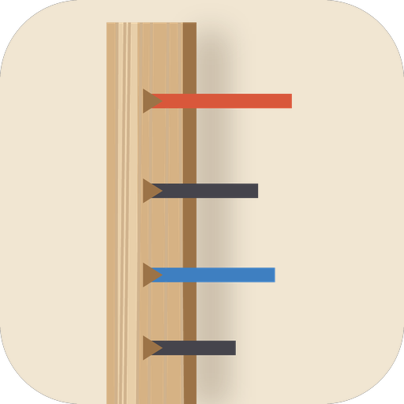
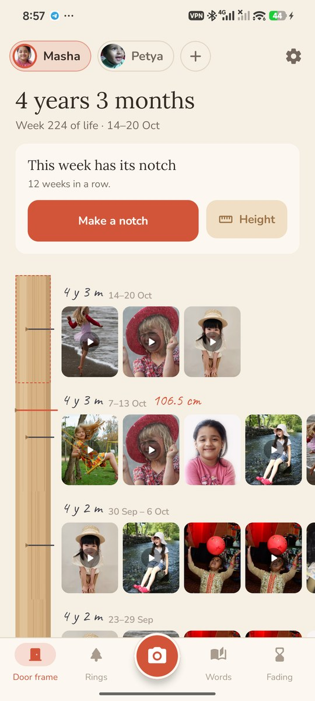
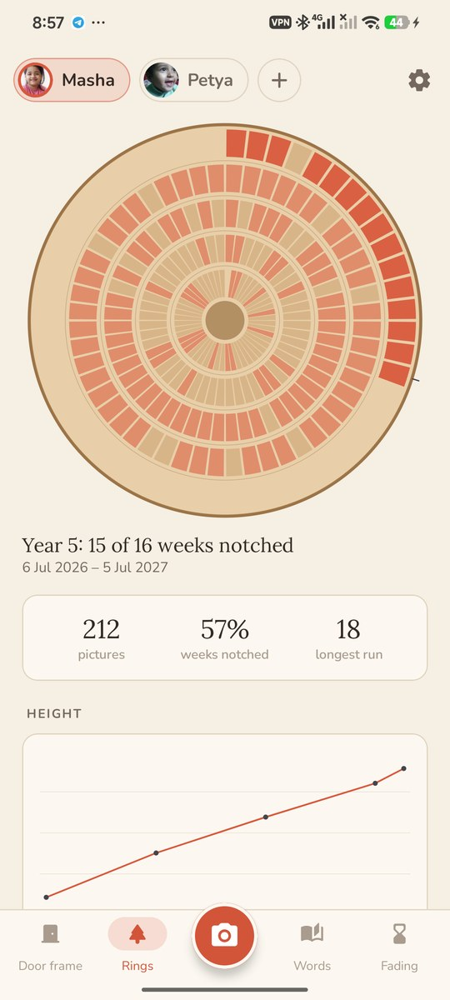
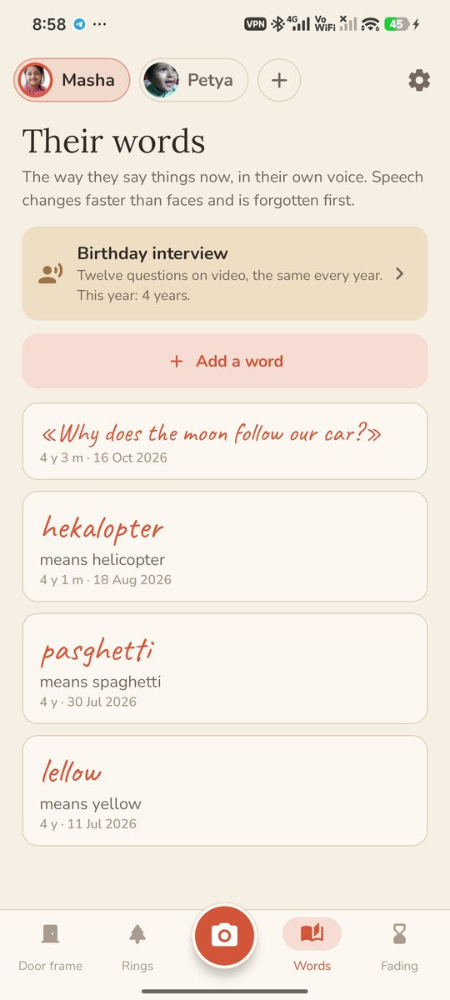
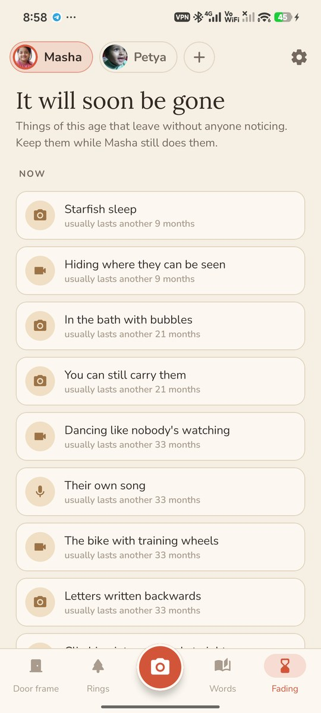
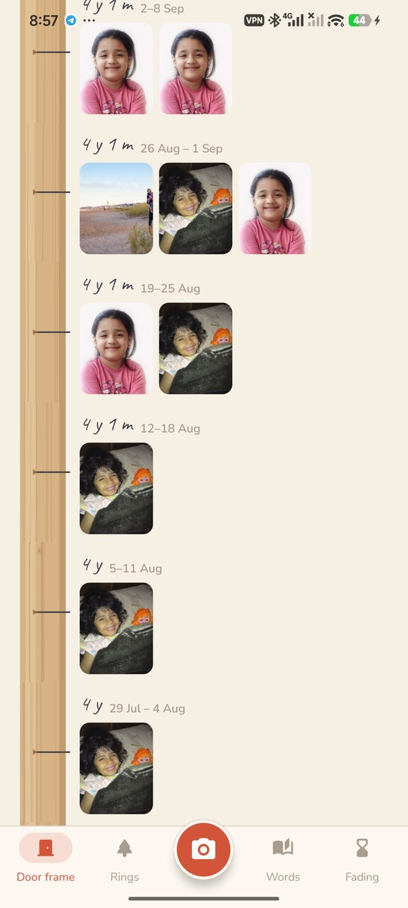
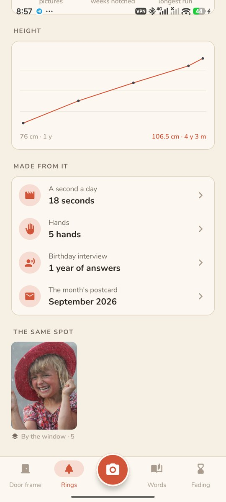
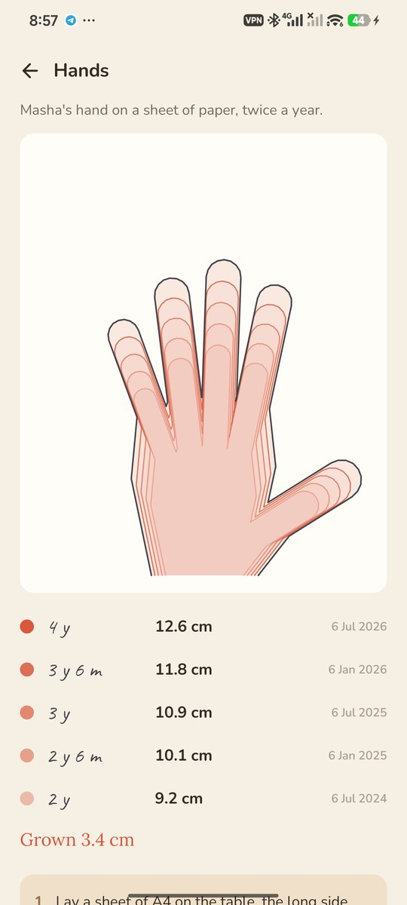
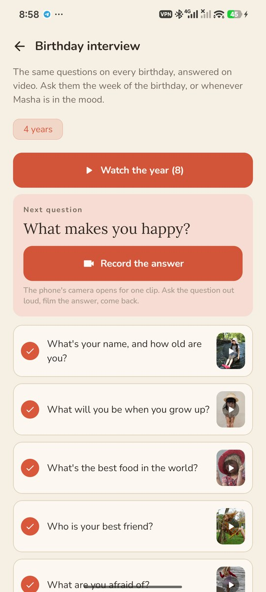
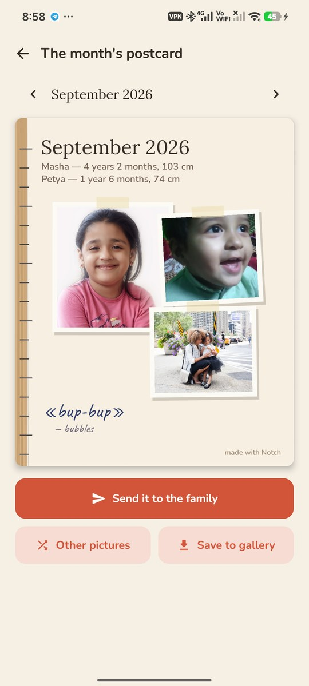

<div align="center">



# Notch

### They grow up faster than the photos do.

*A door frame for each child, the kind you mark their height on, with a notch for every week of their life that has a photo or a clip. Your phone's own camera does the shooting. Free, no ads, no account, nothing leaves the phone.*

[](https://github.com/bigdevwhale/notch/actions/workflows/android.yml)
[](https://github.com/bigdevwhale/notch/releases/latest)


[](LICENSE)

**English** · [Русский](README.ru.md) · [Changelog](CHANGELOG.md)

   

</div>

---

## The idea

A week goes by, then a month, and somehow there is no picture of how they were just then. Children change faster than anyone remembers to photograph them. Notch asks for very little: one picture a week. Each week of a child's life with a photo or a clip gets its notch on the door frame. A week going by empty gets a gentle reminder, at the hour your family usually takes pictures.

## How it works

1. **Add a child**: a name, a birthday and a crayon of their own. Brothers and sisters each get their own door frame.
2. **Make a notch.** Tap the camera, say who is in the picture, and your phone's own camera opens with every mode it has: portrait, night, video. Whatever it takes goes on the door frame when you come back. A copy is kept in Notch; the original stays in your gallery.
3. **Old pictures too.** Pick them from the gallery and each one lands in the week it was taken, so the door frame fills in back to the day they were born.

## What's inside

| | Feature | How it works |
|---|---|---|
| 🚪 | **The door frame** | Weeks of life from the newest down to birth, a notch where there is a picture, pencil lines for heights, a line on every birthday. Empty runs fold up; weeks before the app are "before the door frame", not missed. |
| 🔔 | **Smart reminders** | Only when a week has no picture: midweek and on its last day, at the half hour you usually shoot on that day of the week (learned from your own pictures), never at night. "Masha is 2 years 3 months. This version of her won't come again." |
| 🌳 | **Tree rings** | A childhood as the cross-section of a tree: a ring a year, 52 weeks round each, notched weeks in the child's crayon. Tap a ring for its year. Pictures, weeks notched, the longest run, a height chart. |
| 👻 | **The same spot** | Mark a photo "repeat this spot" (by the door, on the sofa, with the bear). Next time, the earlier picture lies faintly over your phone's camera so the child can be stood where they stood. A year ago is offered too. |
| 🎞️ | **They grow in place** | The pictures of a spot become a film: faces found and lined up by the phone, each picture melting into the next with the age written beneath. |
| ⏱️ | **A second a day** | A short clip a day; the film takes one second from each, with the date and age in pencil in the corner. A month, or a year in six minutes. |
| ⌛ | **It will soon be gone** | 42 things of each age that leave without anyone noticing: holding your finger with the whole hand, starfish sleep, the mixed-up words, the gap-toothed smile. Each says how long it usually lasts. Keep it with a photo, a clip or their voice. |
| 📖 | **Their words** | "Appo" for apple, in their own voice: hold to record. Whole sentences too ("Why does the moon follow our car?"). |
| 🎂 | **Birthday interview** | The same twelve questions every year, answered on video with the phone's camera. Play a year's answers one after another, or one question's answers across the years. |
| ✋ | **Hands** | A hand on a sheet of A4, twice a year. Notch finds the sheet and the hand and traces round it to scale; the outlines sit one inside the other. If it can't find them, draw round with a finger. |
| 👧👦 | **At the same age** | Your son today next to your daughter when she was exactly as old. |
| ✉️ | **The month's postcard** | On the 1st, the month on one card: a few prints, the ages and heights, a word they said. One tap to send it to the family chat. |
| 💾 | **Backup** | Every picture, clip and recording in one zip. |

## Privacy

No account, no cloud, no analytics, no internet permission. Pictures are copied into the app's own storage on the phone and go nowhere unless you share them. Faces are lined up by Android's own face finder, on the phone. The ghost over the camera needs "display over other apps"; it lets every touch through and goes away the moment you come back.

## Screenshots

    

## Build

```bash
./gradlew assembleDebug             # app.notch.dev
./gradlew assembleDebug -Pdemo      # app.notch.demo, a made-up family for screenshots
./gradlew testDebugUnitTest         # unit tests
./gradlew testDebugUnitTest -Prender --tests '*Render*'   # screens and art to app/build/art
```

Kotlin, Jetpack Compose, Room, DataStore, Media3 Transformer for the seconds film, MediaCodec for the growing-face film. No camera code of its own: the phone's camera app is opened through the standard intents and its new pictures are taken in from the gallery.

Demo photos (demo build only) are from Wikimedia Commons and Unsplash; see [docs/demo-credits.txt](docs/demo-credits.txt).

Part of [Stillcraft](https://bigdevwhale.github.io/stillcraft/). MIT licence.
