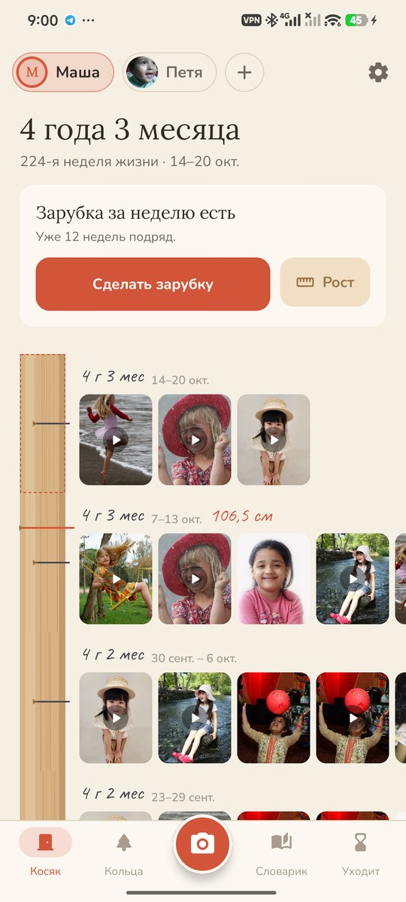
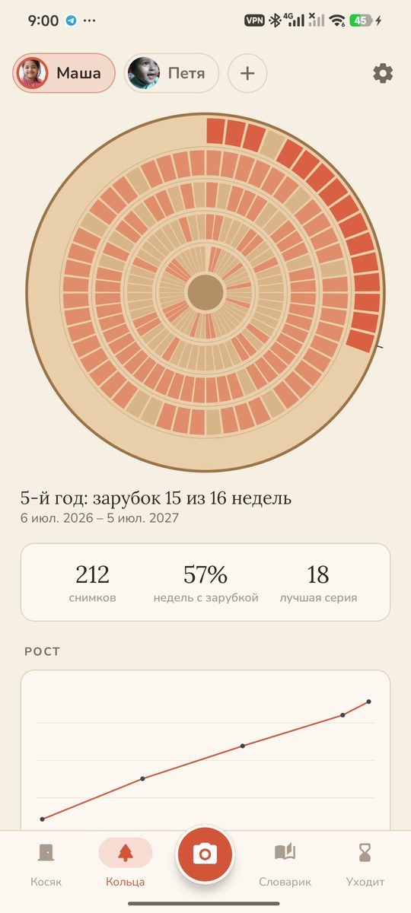
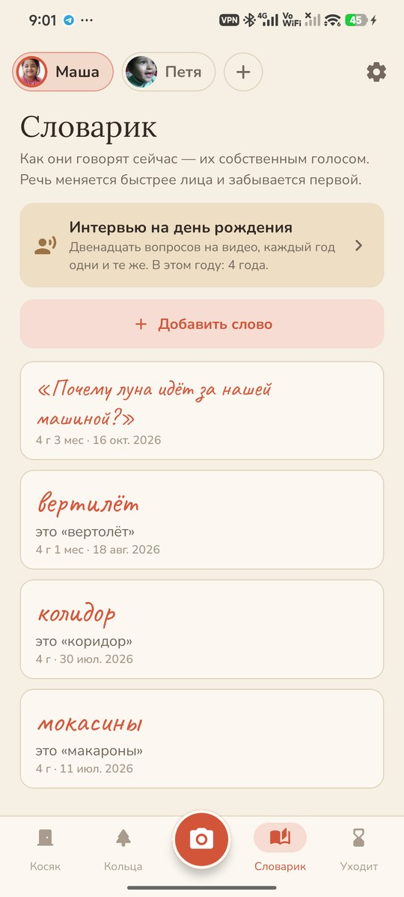
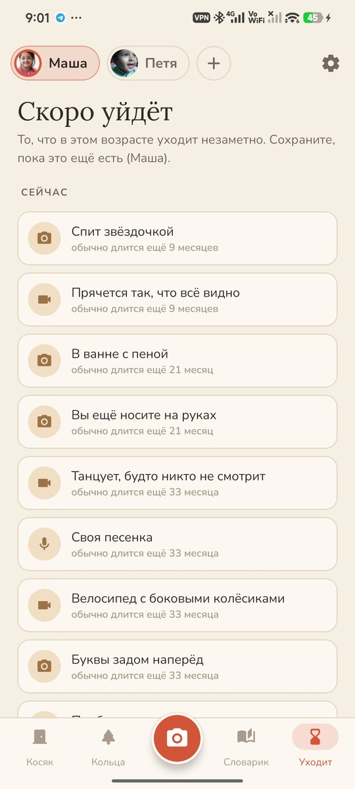
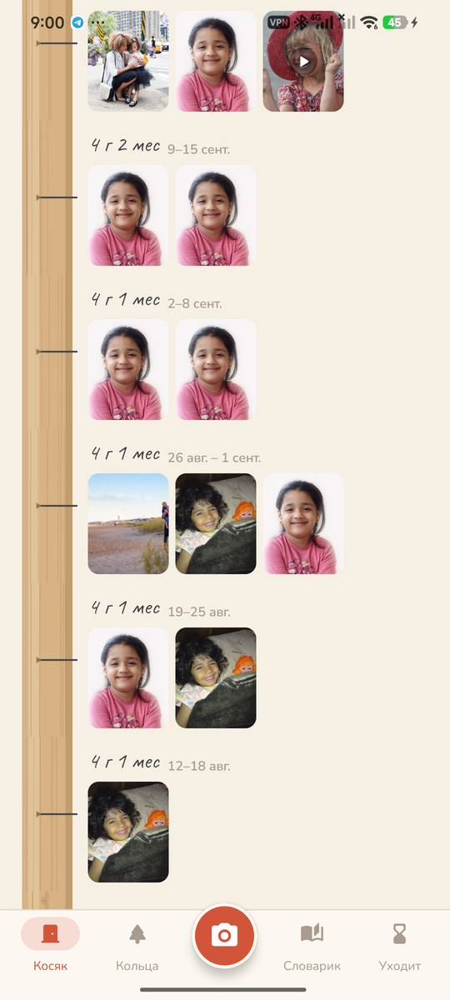
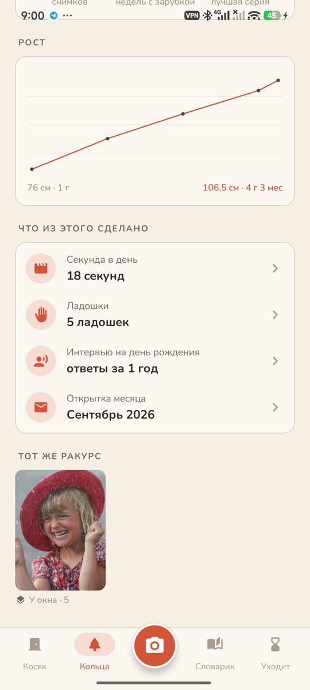
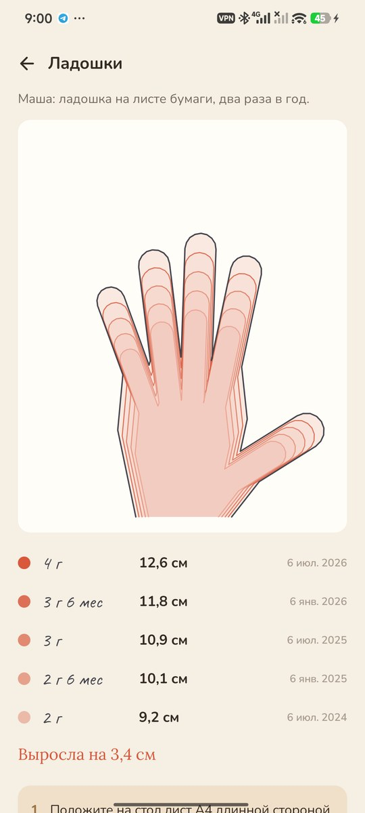
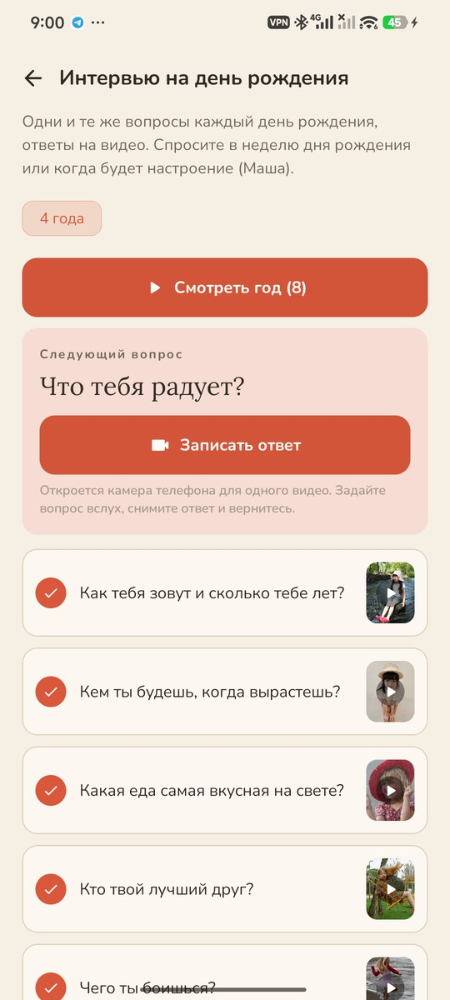
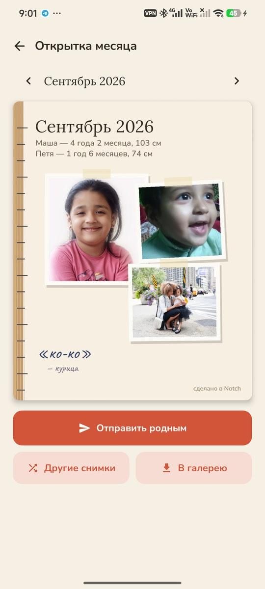

# Notch

### Они растут быстрее, чем копятся фотографии.

*Дверной косяк для каждого ребёнка — тот самый, на котором отмечают рост: по зарубке за каждую неделю жизни, в которую есть фото или видео. Снимает обычная камера телефона. Бесплатно, без рекламы и аккаунта, ничего не уходит с телефона.*

[English](README.md) · **Русский** · [Изменения](CHANGELOG.md)

   

---

## Идея

Проходит неделя, потом месяц, и вдруг оказывается, что нет ни одного снимка, какими они были тогда. Дети меняются быстрее, чем мы успеваем их сфотографировать. Notch просит совсем немного — один снимок в неделю. Каждая неделя жизни с фото или видео получает зарубку на косяке. Если неделя проходит пустой, приходит мягкое напоминание — в тот час, когда в вашей семье обычно фотографируют.

## Как это устроено

1. **Добавьте ребёнка**: имя, день рождения и свой цветной карандаш. У братьев и сестёр — свои косяки.
2. **Сделайте зарубку.** Нажмите на камеру, отметьте, кто в кадре, — откроется камера телефона со всеми её режимами: портрет, ночь, видео. Всё снятое попадёт на косяк, когда вы вернётесь. Копия хранится в Notch, оригинал остаётся в галерее.
3. **Старые снимки тоже.** Выберите их из галереи — каждый ляжет в ту неделю, когда был снят, и косяк заполнится до самого дня рождения.

## Что внутри

| | Функция | Как работает |
|---|---|---|
| 🚪 | **Косяк** | Недели жизни от новой вниз до рождения, зарубка там, где есть снимок, карандашные отметки роста, черта на каждый день рождения. Пустые недели сворачиваются; недели до приложения — «до косяка», а не пропуски. |
| 🔔 | **Умные напоминания** | Только когда за неделю нет снимков: в середине и в последний день — в те полчаса, когда вы обычно снимаете в этот день недели (выучено по вашим же фото), и никогда ночью. «Маше 2 года 3 месяца. Этой версии её больше не будет». |
| 🌳 | **Годичные кольца** | Детство как спил дерева: кольцо за год, 52 недели по кругу, недели с зарубкой — цветом ребёнка. Снимков, процент недель, лучшая серия, график роста. |
| 👻 | **Тот же ракурс** | Отметьте фото «повторять ракурс» — у двери, на диване, с медведем. В следующий раз прошлый кадр полупрозрачно ляжет поверх камеры телефона, чтобы поставить ребёнка туда же. Предлагается и снимок годичной давности. |
| 🎞️ | **Растёт на глазах** | Снимки одного ракурса складываются в фильм: телефон находит и совмещает лица, кадры перетекают один в другой, под ними — возраст. |
| ⏱️ | **Секунда в день** | Короткое видео каждый день; в фильм идёт по секунде из каждого, с датой и возрастом карандашом в углу. Месяц — или год за шесть минут. |
| ⌛ | **Скоро уйдёт** | 42 вещи каждого возраста, которые уходят незаметно: держит палец всей ладошкой, спит звёздочкой, путает слова, улыбка со щербинкой. У каждой — сколько это обычно длится. Сохраните фото, видео или голосом. |
| 📖 | **Словарик** | «Ябуко» вместо «яблоко» — их собственным голосом: удерживайте, чтобы записать. И целые фразы: «Почему луна идёт за нашей машиной?» |
| 🎂 | **Интервью на день рождения** | Каждый год одни и те же двенадцать вопросов, ответы на видео камерой телефона. Смотрите ответы года подряд или ответы на один вопрос за все годы. |
| ✋ | **Ладошки** | Ладошка на листе А4 два раза в год. Notch находит лист и руку и обводит её в настоящем масштабе; контуры ложатся один в другой. Не нашёл — обведите пальцем. |
| 👧👦 | **В том же возрасте** | Сын сегодня рядом с дочкой, когда ей было ровно столько же. |
| ✉️ | **Открытка месяца** | Первого числа — месяц на одной открытке: несколько снимков, возраст и рост, словечко месяца. Отправить в семейный чат одним нажатием. |
| 💾 | **Резервная копия** | Все снимки, видео и записи в одном zip. |

## Приватность

Без аккаунта, облака, аналитики и даже разрешения на интернет. Снимки копируются в хранилище приложения на телефоне и никуда не уходят, пока вы ими не поделитесь. Лица совмещает встроенный в Android поиск лиц, на самом телефоне. Призраку поверх камеры нужно разрешение «Поверх других приложений»; он пропускает все нажатия и исчезает, как только вы возвращаетесь.

## Скриншоты

    

Часть [Stillcraft](https://bigdevwhale.github.io/stillcraft/). Лицензия MIT.
